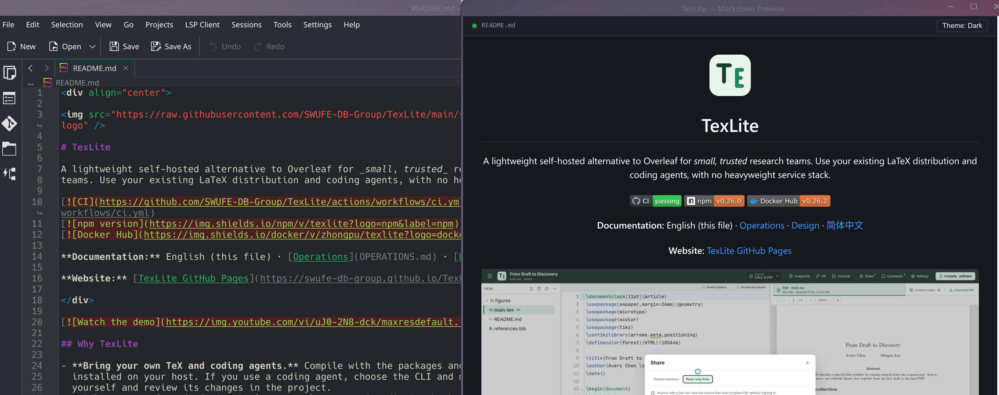

# kate-md-preview

A lightweight, **editor-agnostic** local GitHub-style Markdown live previewer—usable both as a **standalone application** (`md-preview` / `kate-md-preview`) and with **built-in KDE Kate integration**.

It was originally created as a non-invasive way to upgrade KDE Kate's Markdown preview (replacing `QTextBrowser`-based limitations without modifying Kate or system files), while keeping the core completely independent of any editor.



## Features

- **GitHub-accurate rendering**: Uses `markdown-it` + `github-markdown-css` + `highlight.js` with support for raw HTML layouts (`<div align="center">`, `<details>/<summary>`), remote SVG badges, task lists, tables, and GitHub-compatible heading anchors.
- **GitHub Alerts**: Supports `> [!NOTE]`, `> [!TIP]`, `> [!IMPORTANT]`, `> [!WARNING]`, and `> [!CAUTION]`.
- **Mermaid diagrams via [`pele`](https://github.com/obsidianmd/pele)**: Renders ` ```mermaid ` blocks server-side to crisp, themeable SVG with graceful error fallback while editing.
- **Math formulas via KaTeX**: Supports inline `$...$`, display `$$...$$`, and ` ```math ` fenced blocks, with KaTeX stylesheets and fonts served locally (no CDN required).
- **Live reload without flicker**: Watches the parent directory (handling atomic editor saves) and patches the DOM over SSE while preserving scroll position and open `<details>` elements.
- **Relative links and assets**: Automatically scopes each session to the enclosing Git repository root (or parent directory), so relative images and links to sibling `.md` files work out of the box.
- **Auto / Light / Dark themes**: Follows system `prefers-color-scheme` by default and includes a compact segmented icon switcher that also updates `pele` diagram colors.
- **Collapsible document outline**: Toggleable right-side outline (`Outline` button in the topbar, collapsed by default) with scroll-spy highlighting, live reload sync, and responsive sticky-rail / floating-drawer layout for side-by-side tiling.
- **Content zoom controls**: Compact zoom pill (`70%`–`200%`) in the topbar with `Ctrl+=`, `Ctrl+-`, `Ctrl+0`, and `Ctrl+Wheel` support—scales the document cleanly while keeping the topbar and outline crisp.
- **Standalone & Kate-ready**: Works directly from any terminal or editor, and includes `install-kate` / `uninstall-kate` commands for one-step KDE Kate External Tools setup.

## Requirements

- Node.js `>= 20`

## Installation

### From npm (recommended for distribution)

```bash
npm install -g kate-md-preview
```

Or run directly without global installation:

```bash
npx kate-md-preview README.md
```

### From source

```bash
git clone https://github.com/ChenZhongPu/kate-md-preview.git
cd kate-md-preview
npm install --omit=dev
npm link   # optional: exposes kate-md-preview and md-preview on PATH
```

## Standalone usage

Both `kate-md-preview` and `md-preview` invoke the same CLI:

```bash
# Open in your default web browser (starts/reuses a single local background daemon)
md-preview README.md

# Open in a frameless app window (Chrome / Chromium / Brave / Edge)
md-preview --app README.md

# Run in the foreground (stops on Ctrl+C)
md-preview --foreground README.md

# Print the preview URL without opening a browser
md-preview --no-open README.md

# Check or stop the background preview daemon
md-preview --status
md-preview --stop
```

Passing a directory opens its `README.md` if present. Set `KATE_MD_PREVIEW_APP=1` to default to `--app` window mode.

## KDE Kate integration (built-in)

This package includes built-in bindings for **Kate External Tools** (`Tools -> External Tools`), keeping your system files and Kate installation completely untouched.

### 1. Register Kate External Tools

```bash
kate-md-preview install-kate
```

This detects your current Node.js binary (including `fnm` and `volta` shims) and writes two user-level `.ini` entries to `~/.config/kate/externaltools/`, plus a hidden desktop entry (`~/.local/share/applications/chrome-127.0.0.1__kate-md-preview-Default.desktop`, `NoDisplay=true`) on Linux so Chromium `--app` windows match Wayland `app_id` and display a crisp vector SVG taskbar icon:

- **Markdown Preview (GitHub)** — opens the current file in your default browser.
- **Markdown Preview (GitHub App Window)** — opens a chromeless Chromium-based app window (via the fixed `/kate-md-preview` launcher route) suited for side-by-side tiling with Kate.

Use `kate-md-preview install-kate --dry-run` to inspect what would be written before making changes. Running `install-kate` multiple times is idempotent: unchanged entries are left untouched, existing shortcuts are preserved, and updated paths are refreshed cleanly.

### 2. Use in Kate

1. Make sure the **External Tools** plugin is enabled (**Settings → Configure Kate → Plugins → External Tools**).
2. Restart Kate once so it loads the new tool entries.
3. Open any `.md` file and run **Tools → External Tools → Tools → Markdown Preview (GitHub)** (or **App Window**).
4. Optional: bind a shortcut in **Settings → Configure Keyboard Shortcuts** (search for `Markdown Preview`).
5. Saving (`Ctrl+S`) in Kate automatically refreshes the preview in place.

### Upgrading

```bash
npm update -g kate-md-preview
```

- For routine upgrades, you **do not** need to re-run `kate-md-preview install-kate`: the registered `.ini` entries keep pointing to your global npm package, and the CLI automatically restarts any older background preview daemon when the package version changes.
- Only re-run `kate-md-preview install-kate` if a release adds new Kate/desktop entries or if you move your Node.js installation path (e.g., switching Node version managers).

### Uninstall Kate bindings

```bash
kate-md-preview uninstall-kate
```

`uninstall-kate` also supports `--dry-run` and is safe to run repeatedly (it only removes the two `.ini` files and the hidden `.desktop` entry managed by this tool, leaving all other Kate tools intact).

## Using with other editors

Because the core server is completely editor-agnostic, you can bind `md-preview` to any editor:

- **Neovim**: `:!md-preview --app %:p`
- **Helix**: `:sh md-preview --app %{buffer_name}`
- **Any terminal / file manager**: run `md-preview /path/to/file.md`

## Security & runtime design

- The local HTTP server binds strictly to `127.0.0.1` on an ephemeral port.
- Registering files via `POST /api/open` requires a per-process random token stored in `$XDG_RUNTIME_DIR/kate-md-preview.json` (`0600`).
- Static file serving blocks directory traversal outside the registered repository/folder root.
- The background daemon exits automatically after 30 minutes of inactivity with zero connected preview tabs.
- All stylesheets, highlight themes, and KaTeX fonts are served locally from `node_modules`; only external image URLs explicitly referenced inside your Markdown (such as badges) are fetched by your browser.

## Development & testing

```bash
npm test
```

## License

[MIT](LICENSE)
